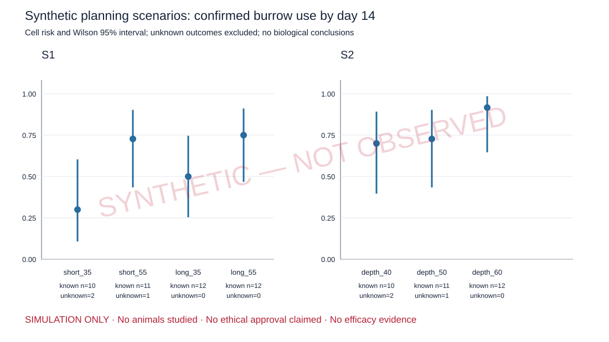

# SYNTHETIC — NOT OBSERVED

These are software demonstration outputs, not experimental findings. No animals were studied. No ethical approval, product efficacy, optimal depth, or power claim is made.

Scenario: **modest**. Seed: `20261002`. Data origin: `SYNTHETIC_NOT_OBSERVED`.

| Study | Condition | Known / allocated | Successes | Unknown | Risk (Wilson 95% CI) |
|---|---|---:|---:|---:|---|
| S1 | short_35 | 10 / 12 | 3 | 2 | 0.300 (0.108, 0.603) |
| S1 | short_55 | 11 / 12 | 8 | 1 | 0.727 (0.434, 0.903) |
| S1 | long_35 | 12 / 12 | 6 | 0 | 0.500 (0.254, 0.746) |
| S1 | long_55 | 12 / 12 | 9 | 0 | 0.750 (0.468, 0.911) |
| S2 | depth_40 | 10 / 12 | 7 | 2 | 0.700 (0.397, 0.892) |
| S2 | depth_50 | 11 / 12 | 8 | 1 | 0.727 (0.434, 0.903) |
| S2 | depth_60 | 12 / 12 | 11 | 0 | 0.917 (0.646, 0.985) |

Monte Carlo p-values and descriptive contrasts are in `analysis.json`; they diagnose the simulator and must not be cited as biological evidence.

Secondary analysis units: one row per animal (activity), one row per independently produced material batch (bench). Time without activity coverage is not scored as zero behaviour. Underground inactivity is not classified as sleep.

- No observed animal data, ethical approval, product efficacy, optimal depth or sample-size justification.
- Primary analyses use known outcomes; complete follow-up plus >=90% endpoint surveillance is required for a negative. Coverage criterion is hypothetical and requires validation.
- Kaplan–Meier retains confirmed events even at low coverage and excludes low-coverage event-free animals; selection and censoring must be noninformative to interpret as a survival estimator. No inferential latency comparisons.
- Daily observations are aggregated within animal; tunnel replicates within independently produced batch. No pseudoreplication as animals or batches.
- Monte Carlo omnibus is within sex in a single cohort. Informative missingness invalidates randomization interpretation; bounds are descriptive sensitivity checks.
- Risk contrasts are descriptive and have no inferential intervals or multiplicity-adjusted claims. Cell Wilson intervals are not simultaneous.
- Parameters and all three fixed-seed scenarios are assumptions. Real multicohort or shared-batch designs require a revised analysis before data collection.

